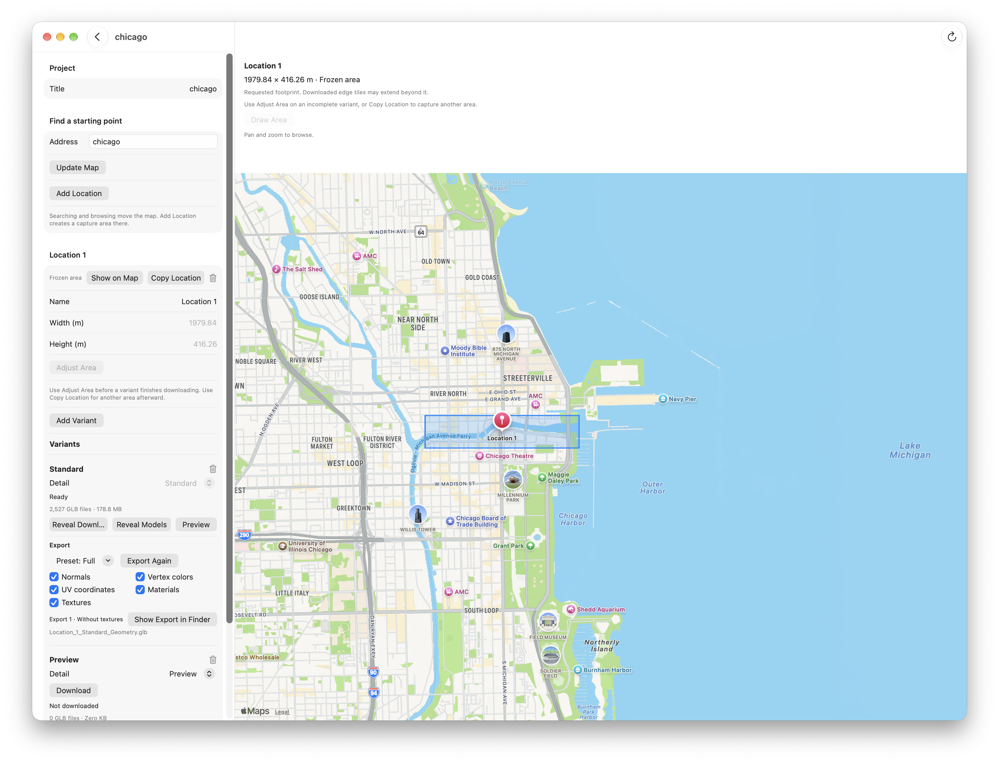
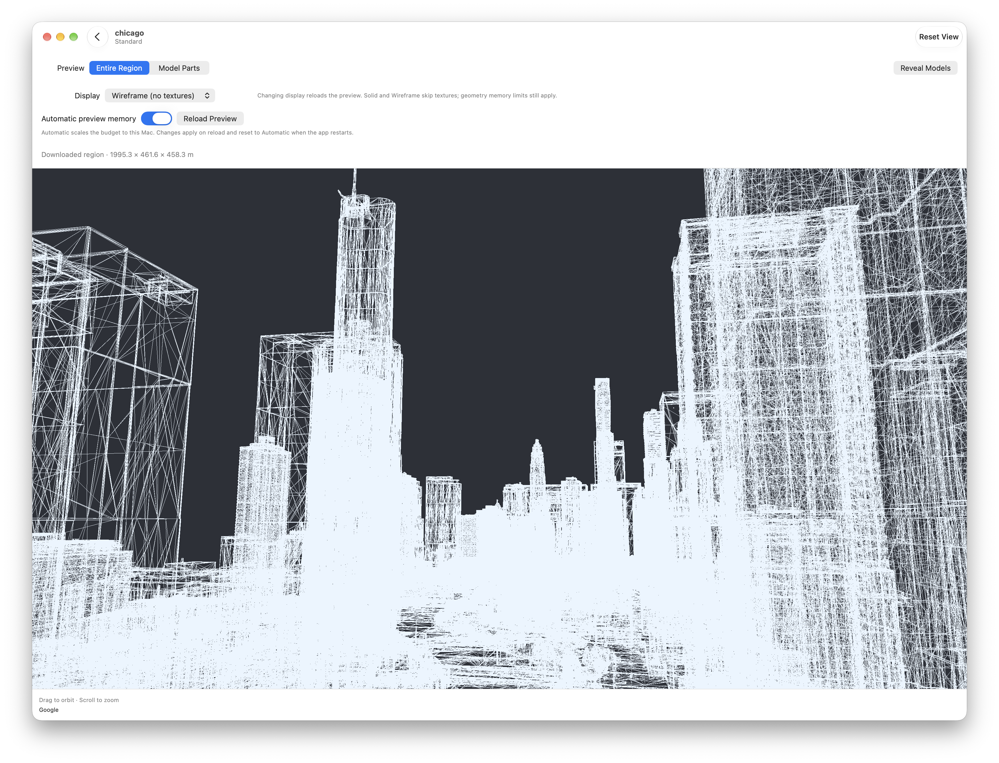
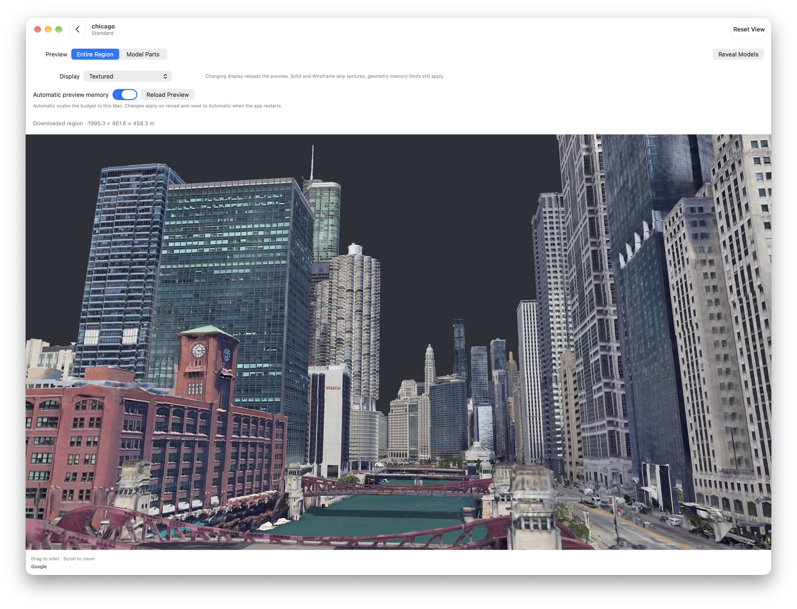

# MessEarthKit

Capture geographic 3D models from Google Photorealistic 3D Tiles, preview them on
your Mac, and export self-contained GLB files for other apps.

## Requirements

- **macOS 15.6 or newer** to run the app.
- **Xcode 26 or newer with Swift 6.2+** to build the app from source.
- An internet connection for map search, location naming and downloading tiles.
- For downloads, a Google Cloud project with billing enabled and a Map Tiles API
  key. Local preview and export of completed captures do not need a Google key.
- Available disk space for captures and exports, and enough GPU memory for the
  models you want to preview. Larger areas and finer detail need more resources.

To run from source, open `MessEarthKit/MessEarthKit.xcodeproj`, select
**MessEarthKitExample → My Mac**, and Run.

## Get a Google API key

1. Open the [Google Cloud Console](https://console.cloud.google.com/) and create
   or select a Cloud project.
2. Link an active billing account and enable **Map Tiles API** for that project.
3. Open [Credentials](https://console.cloud.google.com/apis/credentials), choose
   **Create credentials → API key**, and create a key dedicated to MessEarthKit.
4. Restrict the key to **Map Tiles API**. For this app's direct HTTPS requests,
   use an **IP addresses** application restriction with your public outbound
   IPv4/IPv6 addresses. For rotating IPv6 addresses, you can allow your assigned
   network subnet in CIDR notation; see [IPv6 troubleshooting](#http-403-and-rotating-ipv6-addresses).
   Update these restrictions if your network or VPN changes.
5. Review the project's Map Tiles API quotas and usage-based charges before
   downloading.
6. In MessEarthKit, open **Settings** and paste the key. Choose **Save Key in
   Keychain** to keep it across launches; otherwise it stays in memory.

Google's [setup guide](https://developers.google.com/maps/documentation/tile/get-api-key),
[key restriction guidance](https://developers.google.com/maps/api-security-best-practices)
and [usage and billing guide](https://developers.google.com/maps/documentation/tile/usage-and-billing)
cover the current Cloud settings. API enablement can take a few minutes.

The Google Cloud project controls API access and billing. Projects inside
MessEarthKit organise your captures.

## Create a project

1. Open MessEarthKit and choose **New** in the Projects toolbar.
2. Give the project a name.
3. Open the project to work with its map, locations and capture variants.

Edits save automatically. Projects are stored under
`~/Documents/MessEarthKit/projects/`.

## Capture an area

1. Enter an address and choose **Update Map**, or pan and zoom to your area.
2. Choose **Add Location**. The new location uses the current map centre.
3. Keep its automatic city/coordinate name or enter your own name.
4. Set **Width (m)** and **Height (m)**. You can also move or resize the map box,
   or use **Draw Area** to draw a new rectangle. Choose **Done** when finished.
5. Choose **Add Variant**, then select that variant's **Detail**.
6. Choose **Download** on the variant card.



Adding a location or variant does not download Google tiles. **Download** starts
acquisition for that variant's saved area and detail. Use **Pause Download** and
**Resume Download** if needed. Completed downloads prepare models offline.

Add another variant to capture a different detail level. Detail locks once a
variant starts downloading. **Adjust Area** can update all pending variants
before any completes; afterward, use **Duplicate** for a different area.
Whole intersecting tiles can extend beyond the drawn rectangle.

## Preview

Choose **Preview** on a downloaded variant. If preparation is still running, it
continues before the model is displayed.

The **Display** menu offers:

| Mode | Appearance |
| --- | --- |
| **Wireframe (no textures)** | Triangle edges; the default. |
| **Solid (no textures)** | Neutral shaded surfaces. |
| **Textured** | Captured imagery and materials. |

**Wireframe preview**



**Textured preview**



For larger captures, switch from **Entire Region** to **Model Parts** and use
**Previous** / **Next** to view one part at a time. Solid and Wireframe skip
texture uploads. Preview still needs enough memory for the selected geometry.

Preview choices do not change downloaded files or export options.

## Export

1. Return to the project's variant cards and find the variant you want to export.
2. In its **Export** section, choose a preset or adjust the checkboxes.
3. Choose **Export GLB**. Preparation runs offline first if needed.
4. Choose **Show Export in Finder** beside the completed export.

| Preset | Included data |
| --- | --- |
| **Full** | Positions, triangle indices, normals, vertex colors, UVs, materials and texture images. |
| **Untextured** | The same vertex data and materials, without texture images. |
| **Minimal** | Positions and triangle indices. |

Normals, vertex colors, UV coordinates, materials and texture images can also be
selected individually. Enabling textures enables UVs and materials. Placement,
capture identity and attribution are always retained.

Filenames include the selected contents. For example,
`Chicago_Standard_geom_norm_vcol_uv_mat_tex.glb` contains geometry (`geom`,
positions and triangle indices), normals (`norm`), vertex colors (`vcol`), UVs,
materials (`mat`) and texture images (`tex`). Omitted channels have no tag;
Minimal ends in `_geom.glb`.

Exports are saved in the project's `output/<export UUID>/` folder. **Export
Again** creates another file and keeps earlier exports in the history. Export
does not require the whole capture to fit in Preview.

New app exports also include an optional `.glb.info.json` companion with model
statistics, attribution and a small PNG thumbnail. Keep it beside the GLB for
consumers that support it. The GLB works independently. See the
[companion format](docs/GLB_INFO.md) for SDK export and reader details.

Export choices leave downloaded and prepared sources intact. Omitting images
from an export does not reduce the Google tiles already downloaded.

## Use the output in another app

| Output | What the consuming app needs |
| --- | --- |
| **Exported `.glb`** | A glTF 2.0 importer and renderer supporting static triangle meshes, node transforms and the included material, image and vertex attributes. No EarthKit dependency is required. |
| **Completed capture folder** | MessEarthKit's `EarthCaptureImporter` reads `tileset.json`, referenced GLBs and placement transforms. Another compatible 3D Tiles reader can also be used. Keep referenced files together; source GLBs may require Draco decoding. |
| **Ready prepared collection** | MessEarthKit's `EarthPreparedCollection` opens the catalog and loads aligned model parts. A compatible reader can also use its local `tileset.json`. Preserve the shared placement when combining parts. |

These public Swift APIs return CPU assets for your app to convert and render. See
[SwiftPM](#swiftpm) below for dependency setup and import examples.

For GLB appearance, the consumer should handle embedded PNG/JPEG images, unlit
materials and vertex-color tinting when present. An export without normals needs
normals generated if the app uses lighting. Minimal exports need the consumer's
default surface appearance. See the [glTF 2.0 specification](https://registry.khronos.org/glTF/specs/2.0/glTF-2.0.html).

Local importing and rendering do not need a Google key. Once converted to an
app's own geometry, materials and textures, normal rendering does not need the
GLB decoder. The app can retain the original file for reimport or Reset.

Preserve the capture's attribution when displaying it. A small GLB on disk can
still require substantial memory after decoding geometry and images.

## Troubleshooting

Error messages support text selection and an explicit **Copy Error** action
that copies the complete displayed message to the macOS clipboard. Settings
links to Google Cloud credentials for managing key restrictions. The app
distinguishes recognized Google failures without displaying the server body.

| Symptom | What to check |
| --- | --- |
| Google rejects the key | Check IP/API restrictions, API enablement, billing and quota. Check both public IPv4 and IPv6; temporary IPv6 addresses can rotate. |
| HTTP 403: public IP not allowed | Update the same key used by the app to allow the public outbound addresses Google sees, including VPN routing. See [HTTP 403 and rotating IPv6 addresses](#http-403-and-rotating-ipv6-addresses) below. |
| HTTP 429 | Check the project's root-request quota and service rate limits. Changing region/detail does not reset them. |
| Capture vertex count exceeded | Prepare a completed archive offline with a fitting destination profile. A standalone import must fit its supplied vertex budget. |
| Capture decoded texture bytes exceeded | Prepare offline with a fitting texture profile. Standalone import counts base-level RGBA, not compressed file size or total GPU memory. |
| Key field is empty after relaunch | Choose **Save Key in Keychain** in Settings to retain the key across launches. If already saved, check the Keychain item's app access; see [credential storage details](docs/TECHNICAL_REFERENCE.md#credentials). |

### HTTP 403 and rotating IPv6 addresses

An IP-restricted key can work over IPv4 while Google rejects requests over IPv6.
Temporary IPv6 addresses can rotate, so allowing an individual address may fix
the error only until the next rotation.

1. Open [Google Cloud Credentials](https://console.cloud.google.com/apis/credentials)
   and select the API key entered in the app.
2. Under **Application restrictions → IP addresses**, allow your current public
   outbound IPv4 and IPv6 addresses. Google checks the addresses it sees, which
   can differ from local addresses or change when using a VPN.
3. To cover IPv6 rotation within a network you control, confirm its assigned
   subnet and prefix length in your network/router settings. Allow that subnet
   in CIDR notation instead of listing each temporary address. For example,
   `2001:db8:1234:5678::/64` covers addresses within that `/64`. This is a
   documentation example; use your own assigned subnet. The rule permits any
   device in that subnet that has the key to use it.
4. Remove individual IPv6 entries covered by the subnet rule. Keep your public
   IPv4 entry and the **Map Tiles API** restriction, save, and retry the download.

This covers address rotation within the allowed subnet. If your ISP changes the
network prefix, or you move to another network or VPN, update the allowlist.
See [Google's IP and subnet restriction guidance](https://developers.google.com/maps/api-security-best-practices#restrict_apikey).

## SwiftPM

The [1.0.0 release](https://github.com/jvcleave/MessEarthKit/releases/tag/1.0.0)
requires **macOS 15.6+** and **Swift 6.2+**. It exposes the `MessEarthKit` library;
your app supplies file access and rendering.

### Add the package

In Xcode, choose **File → Add Package Dependencies**, enter
[`https://github.com/jvcleave/MessEarthKit.git`](https://github.com/jvcleave/MessEarthKit.git),
choose **Up to Next Major Version** starting at **1.0.0**, and add the
**MessEarthKit** product to your app target.
See Apple's [package dependency guide](https://developer.apple.com/documentation/xcode/adding-package-dependencies-to-your-app).

For an existing `Package.swift`, add this entry to the package's `dependencies`:

```swift
.package(url: "https://github.com/jvcleave/MessEarthKit.git", from: "1.0.0")
```

Add the library product to the consuming target's `dependencies`:

```swift
.product(name: "MessEarthKit", package: "MessEarthKit")
```

Use an exact version or Git revision when you need a fixed integration. This
checkout includes its native frameworks and recovery source archives under
[`ThirdParty/`](ThirdParty/README.md); normal builds do not download GLTFKit2 or
DracoSwift from upstream.

### Read a tileset or GLB

Pass the URL of a completed capture's `tileset.json`, an individual prepared
model's `tileset.json`, or a self-contained `.glb`:

```swift
import Foundation
import MessEarthKit

func loadCapture(_ sourceURL: URL) async throws -> EarthCapture
{
    let importer = EarthCaptureImporter()
    return try await importer.importFile(fileURL: sourceURL)
}
```

The importer follows the tileset's local references and applies tile/node
transforms. `EarthCapture` contains CPU meshes, material descriptions, encoded
images, bounds, geographic origin and attribution. Convert these values into your
app's mesh and texture resources.

Direct import has bounded defaults. Supply `EarthImportLimits` to the importer
for your app's budgets, or use prepared parts for large captures.

### Load prepared model parts

For a ready `prepared/<preparation UUID>/` folder, page the catalog and consume
one model at a time:

```swift
func loadPreparedParts(
    _ directoryURL: URL,
    consume: (EarthCapture) async throws -> Void
) async throws
{
    let collection = try await EarthPreparedCollection.open(directoryURL: directoryURL)
    guard collection.state == .ready else { throw EarthPreparationError.invalidCollection }
    var offset = 0
    while offset < collection.modelCount
    {
        let page = try await collection.models(offset: offset, limit: 50)
        guard !page.isEmpty else { throw EarthPreparationError.invalidCollection }
        for model in page
        {
            let capture = try await collection.importModel(id: model.id)
            try await consume(capture)
        }
        offset += page.count
    }
}
```

The `consume` callback is your app's conversion/upload step. Preserve each part's
shared local coordinates rather than centering parts independently. Loading parts
separately bounds decoding work; retaining every part still uses their combined
memory.

Run import and resource preparation on a worker. Sandboxed apps must retain file
access to the selected folder throughout loading. Local imports run offline and
need no Google key.

Full capture/preparation/export examples, format contracts and verification
commands are in the [technical reference](docs/TECHNICAL_REFERENCE.md#package-use).
